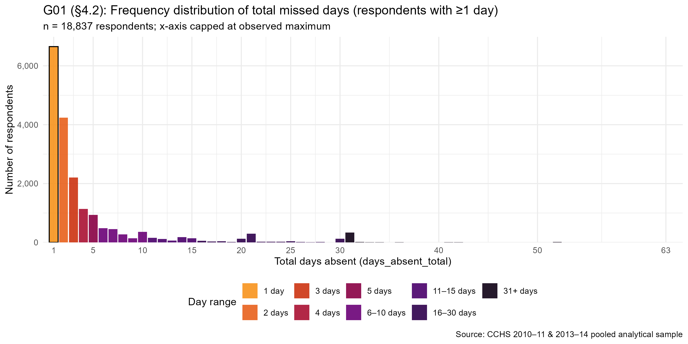
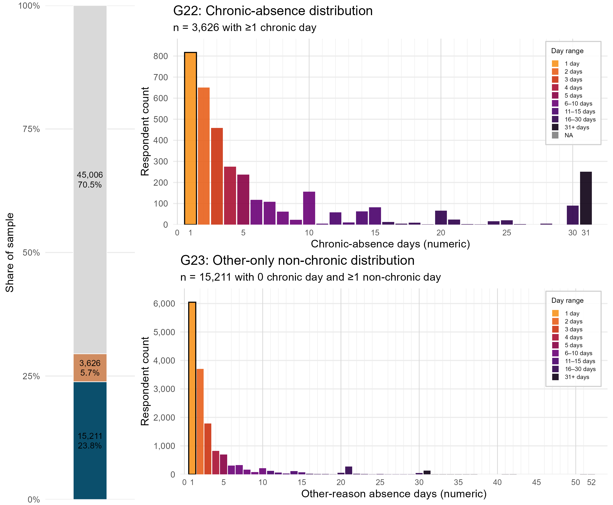

## Predictors of Work Absenteeism Associated with Chronic Conditions Among Canadian Workers

**Authors:** Marc-Andre Blanchette · Oleksandr Koval · Andriy Koval

**Data source:** Canadian Community Health Survey (CCHS) — pooled cycles 2010-2011 and 2013-2014

**Analytic sample:** 63,843 employed respondents (unweighted); weighted N = 17,844,913

---

## Start with the Proposal

The [Project Proposal](docs/project-proposal.qmd) is the authoritative statement of what this
analysis must deliver — the data sources, inclusion and exclusion criteria, variable
specifications, analytic plan, and expected tables, as submitted by the PI.

Every other page on this site exists to answer some part of it, and is best read against it.

---

## Outcome in Focus

The primary outcome is the total number of workdays absent in the three months preceding the
survey, summed across all health-related causes from the Loss of Productivity (LOP) module.
The distribution is heavily zero-inflated (70.5% zeros) with a long right tail — a pattern
that motivates the negative binomial modelling strategy specified in the Project Proposal.

{width=90%}

The chart below shows the same outcome split by respondents who reported at least one chronic
condition versus those who did not. The chronic-condition subgroup drives the right tail of
the distribution.

{width=90%}

---

## About This Site

This site provides a structured, navigable record of the statistical analysis work for the
study above. It is organized as evidence: every section responds to a layer of the Project
Proposal requirements. The navbar follows the analytical reading order.

**Data Primer** contains variable-level traceability. The Variable Inclusion page maps every
construct in §2.2 of the Project Proposal to its concrete PUMF variable and Ellis
implementation. The Univariate Distributions page shows the empirical distribution of every
variable in the analytic sample.

**Predictors** contains five exploratory analyses organized by Andersen Behavioral Model
domain: the primary exposure of chronic conditions (eda-61), and the predisposing (eda-62),
facilitating (eda-63), and needs (eda-64) domains, plus a missingness assessment (eda-65).

**Outcome** contains three exploratory analyses of the LOP absence-day outcome: day
decomposition by cause (eda-5), distribution shape diagnostics (eda-71), and rescaling
(eda-72).

**Model** contains the modelling layer: the bivariate series of one model per predictor
(model-00), a scoped LASSO rehearsal on the predisposing block (model-0), and variable
selection across the full candidate set (model-1).

**Analysis** contains the interpretation layer — reports that read the earlier reports rather
than the data directly. Story 1 (eda-81) explains what the LASSO penalty is doing and aligns
the unadjusted, selected, and adjusted evidence on a single shared axis.

**Pipeline** documents the data infrastructure: how the two raw CCHS files were transported
into a staging database (Ferry), transformed into the analytic dataset (Ellis), and validated
(Test). The CACHE Manifest describes the 70-column, 63,843-row dataset produced by the
pipeline. The INPUT Manifest describes the two raw SPSS files.

**Docs** holds the Site Map — an oriented index of all pages with explicit Project Proposal
linkage — and the Project Proposal itself.

---

## Pipeline Architecture

The data pipeline follows a three-lane Ferry → Ellis → Test pattern, beginning from two raw
CCHS SPSS files and producing a validated analytic SQLite database and Parquet archive.

{width=90%}
